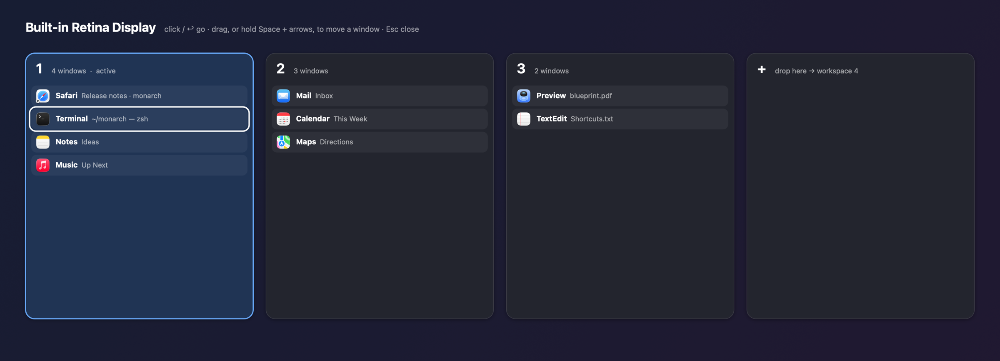

# Monarch

A lightweight native macOS window manager (Swift 6 / AppKit, menu bar app) that replaces a Hammerspoon setup: snapping, auto focus, a custom ⌘Tab switcher, nine workspaces per display, an overview, and three/four-finger trackpad gestures.



*The overview (⌃⌥ Space, or a three-finger swipe up). This image uses sample windows; regenerate it with `Monarch --render-overview-demo docs/images/overview.png`.*

- Event-driven: Carbon hotkeys, AX observers, a listen-only mouse tap; no polling.
- Per-app Accessibility queues with a 0.25 s timeout, so a hung app can't stall the rest.
- No screenshots, no Screen Recording permission.
- Private APIs (MultitouchSupport, SkyLight focus, Dock notifications) are loaded at runtime and checked; if missing, the feature switches off.

## Download

**[Download the latest release](https://github.com/pankaj1980patel/monarch/releases/latest)**. Current version: [Monarch 0.1.0](https://github.com/pankaj1980patel/monarch/releases/download/v0.1.0/Monarch-0.1.0.zip).

1. Unzip it and move `Monarch.app` to `/Applications` or `~/Applications`.
2. The app isn't notarized, so the first time, right-click it and choose **Open**. Alternatively, run `xattr -dr com.apple.quarantine /path/to/Monarch.app`.
3. Allow Monarch in System Settings → Privacy & Security → Accessibility.

Requires macOS 15 or later.

## Build

Requires macOS 15+ and the Swift 6 toolchain (Command Line Tools are enough).

```sh
swift run MonarchChecks        # checks
scripts/build-app.sh --run     # build, sign, install to ~/Applications and launch
```

The build script signs with a local self-signed identity so the Accessibility grant survives rebuilds.

## Shortcuts

Press ⌃⌥ / for the full sheet. Settings live in `~/Library/Application Support/Monarch/config.json` and are applied with ⌃⌥⇧ R (or Reload Configuration in the menu) after a check: a file with mistakes is not applied, and the menu lists them.

## Design

See [docs/blueprint.html](docs/blueprint.html) for the architecture, performance rules and roadmap.
